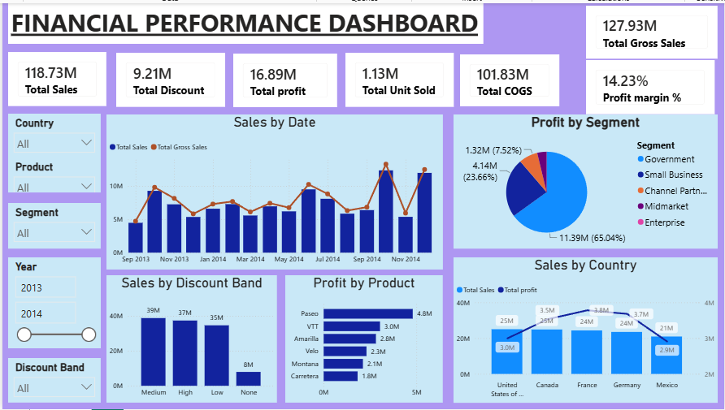

# 💰 FINANCIAL PERFORMANCE ANALYTICS DASHBOARD

### From Financial Data to Smarter Business Decisions 📊

  
  
  

---

## 🚀 PROJECT OVERVIEW

How profitable is a business? Which customer segments generate the highest profit? Which products contribute most to profitability? How do discounts influence sales performance?

This project explores these business questions through an interactive **Financial Performance Analytics Dashboard developed using Microsoft Power BI**.

The dashboard provides a consolidated view of financial performance by analyzing revenue, discounts, profitability, cost of goods sold (COGS), product performance and geographical sales trends.

The objective is to transform financial data into meaningful business insights and support data-driven decision-making.

---

## 📸 DASHBOARD PREVIEW

  

---

## 🎯 BUSINESS OBJECTIVES

The main objectives of this project are:

- 💰 Analyze overall financial performance.
- 📈 Monitor sales and gross sales trends.
- 💹 Evaluate profitability and profit margins.
- 🏷️ Understand the impact of discount strategies.
- 🌍 Compare financial performance across countries.
- 📦 Identify high-profit products.
- 👥 Analyze profitability across customer segments.
- 📅 Track financial performance over time.

---

## 📂 DATASET OVERVIEW

The project uses financial sample data containing business information across different countries, products, customer segments and reporting periods.

The dataset includes the following attributes:

**Financial Metrics**
- Sales
- Gross Sales
- Discounts
- Profit
- Cost of Goods Sold (COGS)
- Units Sold

**Business Dimensions**
- Country
- Product
- Segment
- Discount Band

**Time Dimensions**
- Date
- Month Number
- Month Name
- Year

These attributes support financial analysis across multiple business dimensions.

---

## 📌 KEY PERFORMANCE INDICATORS

The dashboard highlights seven important financial KPIs:

### 💵 Revenue & Sales
- **Total Sales:** 118.73M
- **Total Gross Sales:** 127.93M

### 💹 Profitability
- **Total Profit:** 16.89M
- **Profit Margin:** 14.23%

### 🏷️ Discounts & Costs
- **Total Discount:** 9.21M
- **Total COGS:** 101.83M

### 📦 Sales Volume
- **Total Units Sold:** 1.13M

These KPIs provide an overview of revenue generation, business costs, discounting and profitability.

---

## 📊 FINANCIAL ANALYSIS & BUSINESS INSIGHTS

### 1️⃣ Sales Performance Over Time 📈

Analyzed total sales and gross sales trends across different reporting periods.

- Compared sales performance over time.
- Observed fluctuations in revenue.
- Examined the relationship between gross sales and total sales.

**Business Insight:** Time-based analysis helps identify revenue patterns and periods of stronger or weaker financial performance.

### 2️⃣ Profit Analysis by Segment 👥

Evaluated profit contributions across five customer segments:

- Government
- Small Business
- Channel Partners
- Midmarket
- Enterprise

Government contributes approximately 65.04% of the profit displayed in the dashboard.

**Business Insight:** Segment-level profitability analysis helps identify customer groups contributing significantly to overall profit.

### 3️⃣ Sales Performance by Country 🌍

Compared sales and profit across different geographical markets.

Countries included:

- United States of America
- Canada
- France
- Germany
- Mexico

**Business Insight:** Geographical analysis helps businesses compare market performance and identify potential regional growth opportunities.

### 4️⃣ Sales by Discount Band 🏷️

Analyzed sales performance across four discount categories:

- Medium
- High
- Low
- None

The Medium discount band records the highest displayed sales, approximately 39M.

**Business Insight:** Discount analysis helps businesses evaluate sales performance across discount levels and make better pricing decisions.

### 5️⃣ Profit by Product 📦

Compared profitability across different products:

- Paseo
- VTT
- Amarilla
- Velo
- Montana
- Carretera

Paseo records the highest displayed product profit, approximately 4.8M.

**Business Insight:** Product-level profitability analysis helps identify products that contribute more significantly to business profit.

---

## 🎛️ INTERACTIVE DASHBOARD FEATURES

The dashboard includes interactive slicers for dynamic financial analysis:

- 🌍 Country
- 📦 Product
- 👥 Segment
- 📅 Year
- 🏷️ Discount Band

These filters allow users to explore financial performance across different business dimensions and reporting periods.

---

## 🛠️ TOOLS & TECHNOLOGIES

**Microsoft Power BI**
- Financial dashboard development
- KPI visualization
- Interactive reporting

**Power Query**
- Data preparation
- Data cleaning
- Data transformation

**DAX (Data Analysis Expressions)**
- Financial KPI calculations
- Profitability analysis
- Business metrics

**Microsoft Excel**
- Financial dataset
- Supporting data analysis

---

## 💡 BUSINESS RECOMMENDATIONS

Based on the dashboard analysis, the following recommendations can support better financial decision-making:

**1. Profitability Monitoring**

Regularly monitor profit margins to evaluate overall business performance and identify opportunities for improvement.

**2. Segment Performance**

Understand the profitability of different customer segments and identify opportunities to strengthen business relationships.

**3. Discount Optimization**

Evaluate discount strategies to balance revenue generation and profitability.

**4. Product Performance**

Monitor high-profit products and identify opportunities to improve the performance of lower-profit products.

**5. Geographical Performance**

Compare country-level financial performance to identify potential growth opportunities.

**6. Financial Planning**

Track sales, costs and profitability trends to support better financial planning and business decisions.

---

## 📁 PROJECT STRUCTURE

This repository contains:

📊 **Power BI Dashboard**
- Financial Performance Analytical Dashboard (.pbix)

📂 **Dataset**
- Original financial sample dataset.

🖼️ **Dashboard Preview**
- Financial Performance Analytics Dashboard screenshot.

📄 **Documentation**
- Data Cleaning & Transformation
- DAX Measures
- Business Insights & Recommendations

---

## ▶️ HOW TO EXPLORE THIS PROJECT

1. Clone or download this repository.
2. Open the Power BI `.pbix` file using Microsoft Power BI Desktop.
3. Explore the financial dashboard and KPI cards.
4. Apply interactive slicers to analyze different business segments.
5. Review the financial trends and business insights.

---

## 👩‍💻 ABOUT ME

**Devika Sutar**

Aspiring Data Analyst | Power BI | SQL | Python | Excel

I enjoy analyzing datasets, identifying financial and business trends, and transforming raw data into meaningful insights.

This project demonstrates my practical understanding of financial analytics, business intelligence, KPI development and interactive dashboard creation.

---

  <b>⭐ Thank you for exploring my Financial Performance Analytics project!</b>
   
  <i>Turning Data into Decisions. Turning Insights into Impact.</i>

